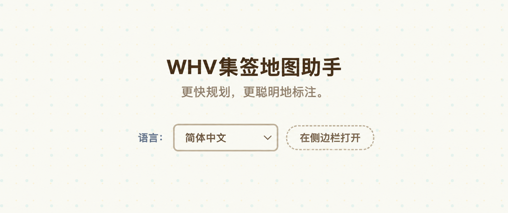
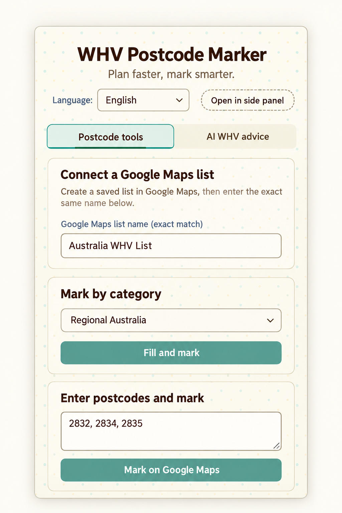
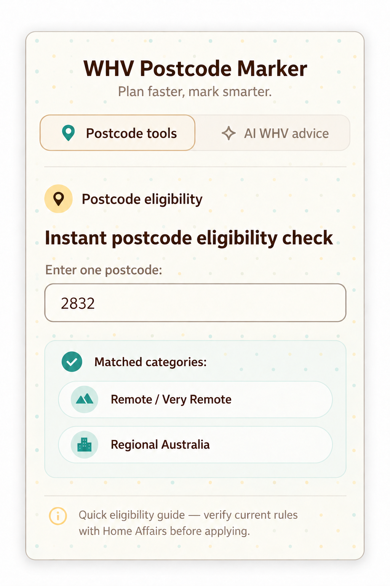
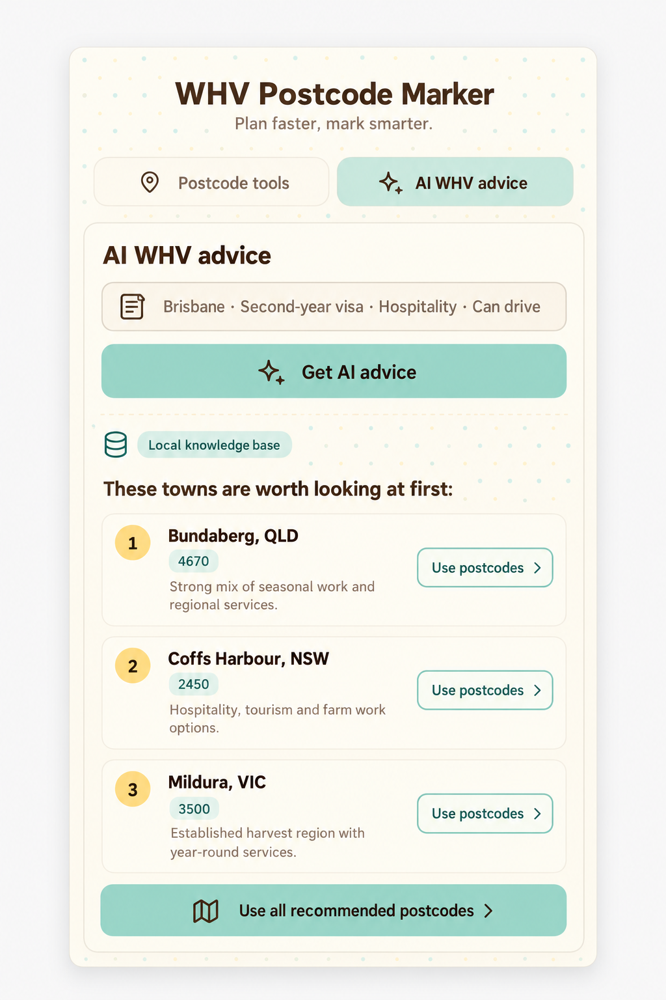

# WHV 集签地图助手

<p align="center">
  
</p>

<p align="center">
  <a href="README.md">English</a> · <strong>简体中文</strong>
</p>

<p align="center">
  
</p>

面向澳洲打工度假签证（WHV）的 Chrome 扩展。它可以把澳洲邮编批量保存到指定的 Google 地图列表，并提供邮编资格预判、按类别标注和 AI 城镇建议。

> 邮编资格与签证政策请以 [Australian Department of Home Affairs](https://immi.homeaffairs.gov.au/) 最新信息为准。本扩展只用于辅助规划，不构成法律或签证建议。

## 功能预览

<table>
  <tr>
    <th>邮编标注</th>
    <th>资格查询</th>
    <th>AI WHV 建议</th>
  </tr>
  <tr>
    <td><a href="docs/images/postcode-tools-preview.png"></a></td>
    <td><a href="docs/images/postcode-eligibility-preview.png"></a></td>
    <td><a href="docs/images/ai-whv-advice-preview.png"></a></td>
  </tr>
</table>

## 主要功能

- **邮编工具**：支持逗号、顿号和范围输入，保留 `0872` 等四位邮编格式。
- **Google 地图列表绑定**：通过完全一致的列表名称，把地点保存到用户手动创建的列表。
- **资格校验**：查询单个邮编，或查看批量邮编命中的区域类别。
- **按类别标注**：快速填充 Remote、Northern、Regional 等类别邮编。
- **AI WHV 建议**：根据位置、目标、行业偏好和交通条件推荐城镇，并可一键填入邮编工具。
- **弹窗与侧边栏**：既可快速打开弹窗，也可常驻 Chrome 侧边栏。
- **中英界面**：可跟随浏览器语言，或手动切换中文和英文。

## 安装

普通用户请优先从 Chrome 网上应用店安装。开发者可在本地加载：

```bash
git clone git@github.com:Jessie-jzn/whv_ai_map_marker.git
cd whv_ai_map_marker
npm test
```

然后打开 `chrome://extensions/`，开启 **开发者模式**，点击 **加载已解压的扩展程序**，选择项目中的 `build/` 目录。

## 使用方法

1. 登录 [Google 地图](https://www.google.com/maps)。
2. 进入 **已保存 → 列表 → 新建列表**，创建一个保存列表，例如“澳洲 WHV 集签列表”。
3. 在扩展的“绑定 Google 地图列表”中填写完全相同的列表名称。
4. 输入邮编或选择资格类别，然后点击标注按钮。
5. 如需城镇建议，切换到 **AI WHV 建议** 标签页。

本扩展不会读取或同步你的 Google 地图列表信息，因此需要使用列表名称完成绑定。名称可以自定义，但 Google 地图与扩展中的名称必须完全一致。

## 性能与可靠性

- 等待 Google 地图实际界面状态，减少固定延时造成的空等。
- 在线 AI 请求设有超时，并在提供方失败时自动回退。
- AI 结果使用本地缓存，相同问题可直接复用。
- 缓存写入串行化，避免多个扩展上下文并发覆盖。
- 标注过程包含进度、暂停、恢复和重复执行保护。

## 隐私

- 自定义列表名称、语言和 AI 设置保存在浏览器本地。
- BYOK API Key 保存在 `chrome.storage.local`。
- 本地 AI 模式不会调用外部模型。
- 使用在线模型时，请同时遵守相应模型提供方的隐私政策。

## 开发与测试

```bash
npm test
npm test --prefix worker
```

```text
build/
├── popup.html             扩展弹窗与侧边栏页面
├── animal-theme.css       轻量动物岛风格主题
├── background.js          扩展后台逻辑
└── src/
    ├── advisor/           AI 推荐、路由与缓存
    ├── eligibility/       邮编解析与资格规则
    ├── marking/           Google 地图标注流程
    └── ui/                标签页与界面初始化
worker/                    在线 AI 路由 Worker
test/                      Node.js 测试
```

## 支持作者

- [Jessie 的 WHV 专题页](https://www.jessieontheroad.com/zh/whv/)
- 欢迎提交 Issue 和 Pull Request。
- 许可证：[MIT](https://choosealicense.com/licenses/mit/)

本扩展免费使用，无应用内广告和追踪。打赏完全自愿，用于支持持续维护与 AI 服务器成本。

<table>
  <tr>
    <th>微信</th>
    <th>支付宝</th>
  </tr>
  <tr>
    <td></td>
    <td></td>
  </tr>
</table>
